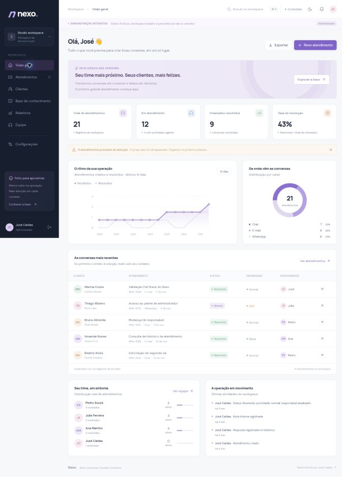
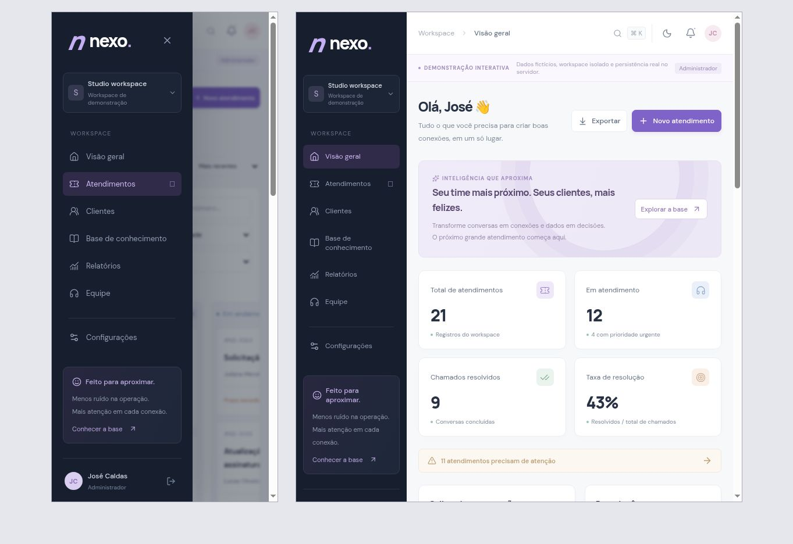

# Nexo · Customer Operations

**Boas conversas. Grandes conexões.**

Uma aplicação Full Stack para organizar atendimentos, clientes, equipe e conhecimento em um workspace. Desenvolvida como projeto de portfólio de **José Caldas**.



## O que você pode experimentar

- **Autenticação real:** criar conta, entrar e sair; sessões no servidor e cookie HttpOnly.
- **Workspaces isolados:** registros de uma organização não ficam acessíveis a outra.
- **Três perfis:** administrador, agente e leitor, com autorização também na API.
- **Atendimentos:** cadastro, responsáveis, prioridades, canais, prazos alvo, respostas, notas internas, resolução e reabertura.
- **Lista e quadro:** busca com atraso de 300 ms, filtros combináveis, ordenação e paginação no servidor. O quadro permite abrir cartões e alterar o status nos detalhes.
- **Histórico e concorrência:** alterações auditadas; versões impedem sobrescrever um chamado atualizado por outra pessoa.
- **Clientes:** cadastro, edição, busca e acesso ao histórico de atendimentos.
- **Base de conhecimento:** criação, edição, categorias, busca, publicação e rascunhos.
- **Assistente contextual:** sugere respostas com regras e busca textual em artigos publicados, mostrando a fonte para revisão.
- **Relatórios reais:** totais, resolução, distribuição de canais, carga por responsável e série diária dos últimos 14 dias.
- **Exportação CSV:** respeita os filtros e neutraliza conteúdo que poderia virar fórmula em planilhas.
- **Experiência de uso:** tema claro/escuro, busca global com Ctrl/⌘ K, estados de carregamento, erros recuperáveis, menu móvel e modais acessíveis.
- **Demonstração isolada:** cria um workspace fictício com 20 atendimentos, 10 clientes, 3 agentes e 6 artigos. É possível escolher o perfil de acesso.

## Stack

| Camada              | Tecnologia                                          |
| ------------------- | --------------------------------------------------- |
| Interface           | React 19 + TypeScript                               |
| Framework e build   | Vinext (API de rotas compatível com Next.js) + Vite |
| API                 | Handlers TypeScript com Web Request/Response        |
| Validação           | Zod                                                 |
| Banco               | SQLite local / Cloudflare D1 na hospedagem          |
| Schema e migrations | Drizzle Kit + SQL versionado                        |
| Consultas           | SQL parametrizado via D1                            |
| Estilo              | CSS com tokens, Grid/Flexbox e breakpoints          |
| Ícones              | Lucide React                                        |
| Testes              | Node Test Runner + SQLite real em memória           |
| Qualidade           | TypeScript, Prettier e workflow GitHub Actions      |

Vinext usa a estrutura de rotas do App Router, mas o runtime deste projeto é Cloudflare Workers. Não é uma aplicação Express nem uma aplicação Next.js executada no Node em produção.

## Rodar no Windows pelo VS Code

Requisito: **Node.js 24 ou superior**, com npm. Não abra o `index.html` e não use Live Server: esta versão precisa da API e do banco.

1. Extraia o ZIP e abra a pasta que contém `package.json` no VS Code.
2. No terminal integrado, execute:

```powershell
npm ci
npm run setup
npm run dev
```

3. Abra **http://localhost:5173** ou o endereço informado no terminal.
4. Clique em **Explorar demo** para testar com dados fictícios, ou em **Criar conta** para iniciar um workspace vazio.

`setup` faz o primeiro build e aplica as migrations no banco local. Na próxima vez, basta executar `npm run dev`. O processo não exige conta Cloudflare ou chave de IA para desenvolvimento local.

Não existe senha padrão de administrador. O demo usa uma identidade temporária gerada no servidor. Para voltar ao mesmo workspace depois de sair, crie uma conta normal e utilize seu e-mail e senha. O demo pode ser retomado enquanto a sessão de sete dias permanecer válida; sair encerra o acesso à identidade temporária.

O banco local fica em `.wrangler/state` e não entra no Git. Bancos local e hospedado são independentes. Para apagar todos os dados locais e recomeçar, pare o servidor, remova essa pasta e execute `npm run setup` novamente.

## Comandos

| Comando               | Finalidade                                               |
| --------------------- | -------------------------------------------------------- |
| `npm ci`              | Instalar exatamente o lockfile                           |
| `npm run setup`       | Primeiro build e migrations locais                       |
| `npm run dev`         | Desenvolvimento com atualização de código                |
| `npm run typecheck`   | Verificação de tipos                                     |
| `npm test`            | Testes da API e regras de acesso                         |
| `npm run build`       | Build completo do Worker e frontend                      |
| `npm run start`       | Executar o build localmente com Wrangler                 |
| `npm run db:generate` | Gerar migration após mudar o schema                      |
| `npm run db:migrate`  | Aplicar apenas migrations ainda não aplicadas localmente |
| `npm run format`      | Formatar o código da aplicação                           |

## Organização

| Pasta                            | Responsabilidade                                                                                    |
| -------------------------------- | --------------------------------------------------------------------------------------------------- |
| `app/`                           | Página, layout, estilos e entrada das rotas da API                                                  |
| `features/`                      | Telas agrupadas por domínio: auth, dashboard, tickets, clients, knowledge, team, reports e settings |
| `components/`                    | Estrutura da aplicação, componentes de interface e busca global                                     |
| `hooks/`                         | Carregamento de recursos com descarte de respostas obsoletas                                        |
| `lib/`                           | Cliente HTTP e formatação                                                                           |
| `shared/`                        | Contratos TypeScript e rótulos do domínio                                                           |
| `server/`                        | API, segurança, validação, acesso ao banco e seed demonstrativo                                     |
| `db/` e `drizzle/`               | Schema, índices e migrations versionadas                                                            |
| `tests/`                         | Cenários de integração com banco SQLite real                                                        |
| `docs/`                          | Arquitetura, endpoints, validação e roteiro de apresentação                                         |
| `scripts/`, `worker/`, `vendor/` | Runtime de desenvolvimento e hospedagem                                                             |

## Qualidade e validação

A entrega foi verificada com typecheck, build do Worker e **9 cenários automatizados de integração**. Os testes cobrem autenticação, revogação de sessão, fluxo completo de atendimento, conflitos de versão, permissões por perfil, isolamento entre workspaces, validação, origem das requisições, exportação, rascunhos, paginação e limite de tentativas.

Também foram exercitados no navegador: demo, cadastro de atendimento, sugestão com fonte, resposta, nota interna, resolução, busca, cadastro de cliente, criação/leitura de artigo, busca global e troca de tema. Layouts foram inspecionados em desktop e em frames de 390 e 768 px. Isso é conferência de viewport, não teste em aparelho físico ou auditoria formal de acessibilidade.



## Limites claros

- As respostas são persistidas no histórico; **não são enviadas por e-mail, WhatsApp ou chat externo**.
- O assistente é baseado em **regras e busca textual**, sem IA generativa, embeddings ou chamadas pagas.
- O projeto não inclui cobrança, anexos, notificações push, recuperação de senha, confirmação de e-mail ou convite por e-mail.
- Os membros são criados diretamente pelo administrador. Gestão de senha e remoção de membros são evoluções futuras.
- Não há atualização em tempo real; listagens recarregam ao navegar ou após ações locais.
- Clientes, artigos e histórico usam limites de leitura de 500, 200 e 100 registros; a fila de chamados é paginada, o quadro mostra até 100 cartões e o CSV até 5.000 registros.
- O demo é persistido, mas não tem rotina automática de limpeza. Não foi executado teste de carga nem validação com dados reais de clientes.
- É um projeto de portfólio com controles de segurança implementados, não um serviço comercial auditado. Veja [SECURITY.md](SECURITY.md) para os controles e lacunas.

## Para apresentar em uma entrevista

Comece em [docs/DEMO.md](docs/DEMO.md). Explique o problema atendido, mostre um fluxo completo e depois abra os testes de isolamento e concorrência. A melhor apresentação é aquela em que você consegue justificar e modificar o código.

Leia também [Arquitetura](docs/ARCHITECTURE.md), [API](docs/API.md) e [Validação](docs/VALIDATION.md).

## Publicação

A versão hospedada nesta entrega mantém o acesso privado. Ela não é um link público para recrutadores. Para outra hospedagem, configure um Worker com o binding `DB`, aplique as migrations e publique o build gerado em `dist/server`. O código depende do runtime D1/Workers; hospedá-lo como arquivos estáticos em uma plataforma não executará a API.

O ZIP de distribuição contém a configuração local de banco sem a identidade da hospedagem original. Segredos, banco local, sessões e `node_modules` não fazem parte dele.
