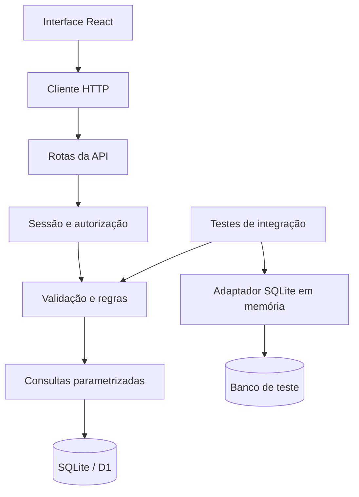
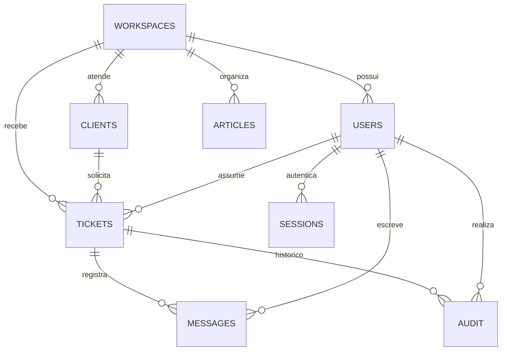

# Arquitetura do Nexo

## Fronteiras

A interface React chama uma API HTTP da mesma origem. O handler de rotas do framework fornece o binding D1 para `server/api.ts`. O handler valida os dados, resolve a sessão, autoriza a operação e executa consultas parametrizadas. Contratos públicos ficam em `shared/contracts.ts`; hashes de senha e tokens não entram nesses contratos.

## Modelo de dados

Há ainda a tabela `rate_limits`, usada para controlar tentativas de autenticação e escrita. Identificadores são UUIDs. E-mails de usuários são únicos globalmente; e-mails de clientes são únicos por workspace. Números de chamados são únicos dentro do workspace. Índices cobrem organização, data e status.

## Autenticação

Cadastro cria workspace e administrador em um batch atômico. Senhas são derivadas com PBKDF2/SHA-256, salt aleatório e 100.000 iterações, respeitando o runtime Web Crypto utilizado. Login retorna um token aleatório por cookie HttpOnly/SameSite=Lax; somente o SHA-256 desse token fica em `sessions`. Cookies usam Secure quando a requisição é HTTPS. A sessão dura sete dias e logout remove o registro correspondente.

Não se usa localStorage para identidade ou registros de negócio. O armazenamento do navegador guarda apenas a escolha de tema.

## Autorização e isolamento

Toda consulta autenticada obtém o workspace da sessão no servidor. O cliente não escolhe um workspace por parâmetro. Os filtros de organização são aplicados nas consultas e nas verificações de relacionamento, inclusive cliente e responsável associados ao chamado. Referências de outro workspace retornam 400 ou 404, sem revelar o registro.

| Operação                                      | Admin | Agente | Leitor |
| --------------------------------------------- | ----- | ------ | ------ |
| Consultar fila, clientes, equipe e relatórios | Sim   | Sim    | Sim    |
| Consultar artigos publicados                  | Sim   | Sim    | Sim    |
| Consultar rascunhos                           | Sim   | Sim    | Não    |
| Gerenciar atendimentos, clientes e artigos    | Sim   | Sim    | Não    |
| Criar membros e alterar workspace             | Sim   | Não    | Não    |
| Atualizar o próprio nome                      | Sim   | Sim    | Não    |

Notas internas são visíveis aos membros autenticados do workspace, incluindo leitores. Não existe portal público de clientes nesta versão.

## Concorrência e transações

Cada chamado tem uma versão. A interface envia essa versão nas alterações. A API executa `UPDATE ... WHERE version = ?` e incrementa a versão. Quando nenhum registro é atualizado, responde 409. A atualização e seu evento de auditoria são executados no mesmo batch.

Mensagens são inseridas com uma condição que confirma que o chamado ainda está aberto. Mensagem, auditoria e atualização de versão/data são agrupadas em um batch. Assim, uma resolução concorrente não permite registrar uma mensagem em um chamado já resolvido. A numeração de chamados usa `INSERT ... SELECT MAX(number)+1` em uma única instrução, protegida também por índice único por workspace.

Criações/edições de cliente e artigo usam uma instrução atômica para o registro e uma operação posterior para a auditoria. Essa auditoria não é transacional com a alteração; consolidar ambas em batch é uma evolução apropriada antes de um uso comercial.

## Dados demonstrativos

O seed só roda quando alguém solicita explicitamente o demo. Ele cria dados em um workspace novo, sem alterar workspaces existentes. Contas normais começam vazias. Credenciais de identidades demonstrativas não são divulgadas; o acesso depende da sessão gerada. Não há limpeza automática dos demos ainda.

## Frontend

As telas são divididas por domínio. Componentes básicos centralizam botões, campos, estados vazios, modais e feedback. `useResource` carrega endpoints, mostra estado de erro e ignora respostas de requisições antigas após mudança de URL ou desmontagem. Alterações locais invalidam os recursos relevantes. Busca na fila usa debounce, filtros são processados no servidor e os resultados são paginados.

O roteamento das seções usa hash; detalhes abrem em um modal. O runtime de rotas é Vinext, que usa a convenção de diretórios do App Router com build Vite para Workers. A API de negócio depende de uma interface pequena de banco, permitindo testá-la em Node com SQLite real sem simular o navegador.

## Responsividade

Grid e Flexbox reorganizam os módulos. O menu vira navegação lateral acionável no celular. Tabelas e quadro têm rolagem própria. Formulários e detalhes tornam-se uma coluna em telas estreitas. Modais usam `dialog`, com foco controlado pelo navegador e fechamento por Escape. Estilos respeitam `prefers-reduced-motion`.

## Tradeoffs

SQLite/D1 reduz a infraestrutura necessária para explorar o projeto e mantém SQL relacional real. O acesso usa SQL parametrizado; Drizzle define o schema e gera migrations, sem impor ORM às consultas. O assistente determinístico permite uma demonstração sem custo de API e sem fingir integração com LLM. Busca textual, gráficos SVG e um hook de recursos mantêm dependências e comportamento compreensíveis.

Antes de escala comercial: paginação dos diretórios, índices e busca em texto completo medidos por carga, controle de quotas, recuperação de conta, MFA/SSO, observabilidade, limpeza de sessões/demos e auditoria integralmente transacional.
