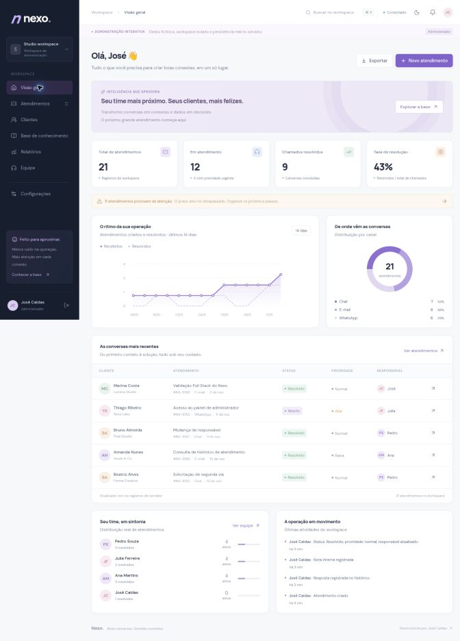
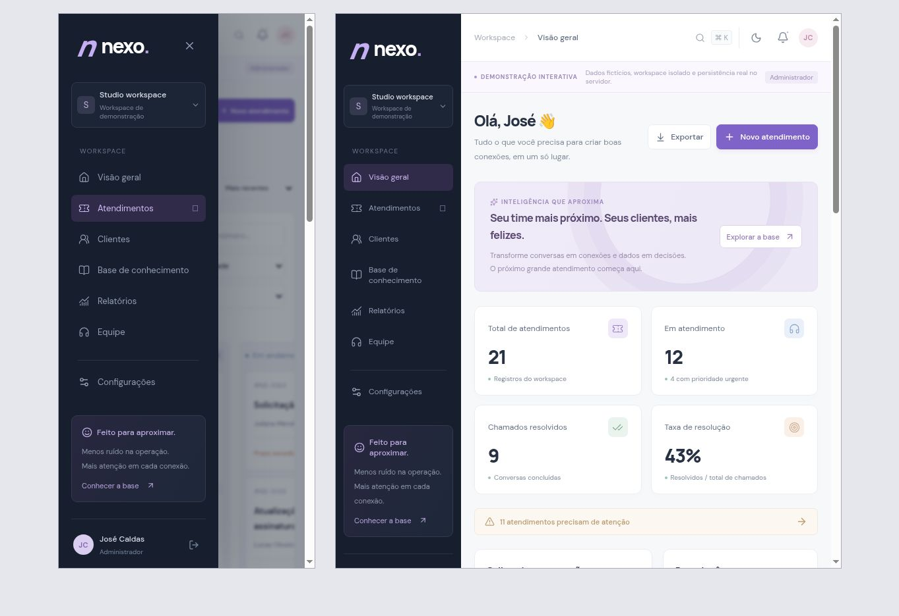

# Nexo — Customer Operations

**Boas conversas. Grandes conexões.**

Plataforma Full Stack para centralizar atendimentos, organizar clientes e conectar equipes. O Nexo reúne gestão de chamados, base de conhecimento e relatórios em uma interface responsiva, com temas claro e escuro.

Projeto de portfólio desenvolvido por **José Caldas**.



## Sobre o projeto

O Nexo representa o fluxo de trabalho de uma equipe de atendimento: identificar o cliente, registrar uma solicitação, definir prioridade e responsável, acompanhar a conversa e concluir o chamado.

A aplicação combina frontend em React e TypeScript com API, autenticação e banco de dados relacional. As regras de acesso são verificadas no servidor, com isolamento dos registros por workspace.

## Funcionalidades

### Gestão de atendimentos

- Criação de chamados vinculados a clientes.
- Visualização em lista ou quadro.
- Busca, filtros combinados, ordenação e paginação no servidor.
- Definição de prioridade, responsável e canal de origem.
- Prazos alvo calculados conforme a prioridade.
- Histórico de respostas e notas internas.
- Resolução e reabertura de chamados.
- Registro de atividades.
- Controle de versão para evitar sobrescrever alterações simultâneas.

### Clientes e conhecimento

- Cadastro e edição de clientes.
- Busca por nome, empresa ou e-mail.
- Consulta ao histórico de atendimentos de cada cliente.
- Criação e edição de artigos.
- Organização por categorias.
- Publicação de artigos e manutenção de rascunhos.
- Sugestões de resposta baseadas em regras e artigos publicados, com indicação da fonte.

### Equipe e acesso

- Cadastro e login de usuários.
- Sessões persistidas no servidor.
- Workspaces com dados separados.
- Perfis de administrador, agente e leitor.
- Autorização aplicada na API.
- Cadastro de membros pelo administrador.

### Relatórios e experiência

- Indicadores calculados com os registros do workspace.
- Distribuição por status, canal e responsável.
- Gráfico diário dos últimos 14 dias.
- Exportação CSV com os filtros selecionados.
- Busca global com `Ctrl + K` ou `⌘ + K`.
- Temas claro e escuro.
- Layout responsivo, menu móvel e feedback de carregamento e erro.

## Tecnologias

| Camada | Tecnologias |
| --- | --- |
| Frontend | React 19 e TypeScript |
| Framework e build | Vinext e Vite |
| Backend | API em TypeScript com Web Request/Response |
| Validação | Zod |
| Banco de dados | SQLite local e Cloudflare D1 na hospedagem |
| Schema e migrations | Drizzle Kit e SQL versionado |
| Consultas | SQL parametrizado |
| Estilização | CSS com tokens, Grid, Flexbox e media queries |
| Ícones | Lucide React |
| Testes | Node Test Runner e SQLite em memória |
| Qualidade | TypeScript, Prettier e configuração de GitHub Actions |

O Vinext utiliza convenções de rotas compatíveis com o App Router do Next.js. O build deste projeto tem como destino o runtime Cloudflare Workers.

## Executar localmente

### Requisitos

- Node.js **24 ou superior**.
- npm.

Após clonar o repositório, entre na pasta da aplicação:

```bash
cd Nexo-FullStack
```

Instale as dependências:

```bash
npm ci
```

Prepare o build inicial e o banco local:

```bash
npm run setup
```

Inicie o ambiente de desenvolvimento:

```bash
npm run dev
```

Abra **http://localhost:5173** ou o endereço informado no terminal.

Nas próximas execuções, basta utilizar:

```bash
npm run dev
```

> A aplicação precisa da API e do banco de dados. Para executá-la, utilize os comandos acima em vez de abrir um arquivo HTML pelo Live Server.

## Explorar a demonstração

Na tela inicial, clique em **Explorar demo** e escolha um perfil de acesso.

Cada demonstração cria um workspace isolado com dados fictícios:

- 20 atendimentos.
- 10 clientes.
- 3 agentes, além do usuário da demonstração.
- 6 artigos, incluindo um rascunho.

Não é necessário configurar uma chave de IA ou uma conta Cloudflare para executar a demonstração local.

Para manter um workspace acessível por e-mail e senha, utilize **Criar conta**. Contas normais começam com os registros vazios.

## Perfis de acesso

| Recurso | Administrador | Agente | Leitor |
| --- | --- | --- | --- |
| Consultar atendimentos, clientes e relatórios | Sim | Sim | Sim |
| Gerenciar atendimentos e clientes | Sim | Sim | Não |
| Criar e editar artigos | Sim | Sim | Não |
| Consultar artigos publicados | Sim | Sim | Sim |
| Consultar rascunhos | Sim | Sim | Não |
| Cadastrar membros | Sim | Não | Não |
| Alterar o nome do workspace | Sim | Não | Não |

## Organização do código

| Diretório | Responsabilidade |
| --- | --- |
| `app/` | Página, layout, estilos e entrada das rotas da API |
| `features/` | Funcionalidades organizadas por domínio |
| `components/` | Componentes compartilhados e estrutura da interface |
| `hooks/` | Carregamento e atualização de recursos |
| `lib/` | Cliente HTTP e funções de formatação |
| `shared/` | Contratos TypeScript e definições do domínio |
| `server/` | API, autenticação, autorização e validação |
| `db/` | Schema do banco de dados |
| `drizzle/` | Migrations SQL versionadas |
| `tests/` | Testes de integração |
| `docs/` | Documentação técnica e capturas de tela |
| `worker/` | Entrada do runtime de produção |

Os diretórios acima estão dentro de `Nexo-FullStack/`.

## Testes e qualidade

Execute dentro da pasta da aplicação:

```bash
npm run typecheck
npm test
npm run build
```

O projeto inclui **9 cenários de integração**, cobrindo:

- Autenticação e revogação de sessão.
- Fluxo completo de atendimento.
- Conflitos de versão.
- Isolamento entre workspaces.
- Permissões por perfil.
- Validação de dados e origem das requisições.
- Exportação CSV e neutralização de fórmulas.
- Publicação de artigos e acesso a rascunhos.
- Paginação, filtros e limite de tentativas de autenticação.

O workflow de GitHub Actions está configurado para executar instalação, verificação de tipos, testes e build.

## Responsividade

A interface foi conferida em desktop e em viewports de celular e tablet, incluindo:

- Dashboard e indicadores.
- Navegação móvel.
- Filtros de atendimento.
- Quadro de chamados.
- Formulários e modais.

Tabelas e quadro possuem rolagem própria para preservar a organização dos dados em telas menores.



## Decisões técnicas

- **Permissões no servidor:** esconder um botão não substitui a autorização da operação.
- **Isolamento por workspace:** o servidor obtém a organização pela sessão autenticada.
- **Controle de concorrência:** alterações enviam a versão atual do chamado; versões desatualizadas recebem HTTP 409.
- **Persistência relacional:** registros de negócio ficam no banco; o armazenamento local do navegador guarda apenas a preferência de tema.
- **Testes com SQL real:** a API é exercitada com SQLite em memória e as migrations do projeto.
- **Assistente com fonte:** sugestões utilizam artigos publicados e permanecem sujeitas à revisão de quem atende.

## Escopo atual

O Nexo é um projeto funcional de portfólio.

- Respostas são registradas no histórico, sem envio externo por e-mail ou WhatsApp.
- Os canais representam a origem informada do atendimento.
- O assistente utiliza regras e busca textual, sem IA generativa.
- Recuperação de senha, confirmação de e-mail, anexos e notificações em tempo real são evoluções futuras.
- A execução depende do runtime Workers/D1; uma hospedagem apenas estática não executa a API.

## Documentação

- [Arquitetura](Nexo-FullStack/docs/ARCHITECTURE.md)
- [Endpoints da API](Nexo-FullStack/docs/API.md)
- [Validação](Nexo-FullStack/docs/VALIDATION.md)
- [Roteiro de demonstração](Nexo-FullStack/docs/DEMO.md)
- [Controles e limites de segurança](Nexo-FullStack/SECURITY.md)
- [Instruções para Windows](Nexo-FullStack/INICIAR-NO-WINDOWS.md)

## Autor

**José Caldas**

Estudante de Análise e Desenvolvimento de Sistemas, com foco em desenvolvimento Full Stack.

[Meu GitHub](https://github.com/JoseCaldinhas)
